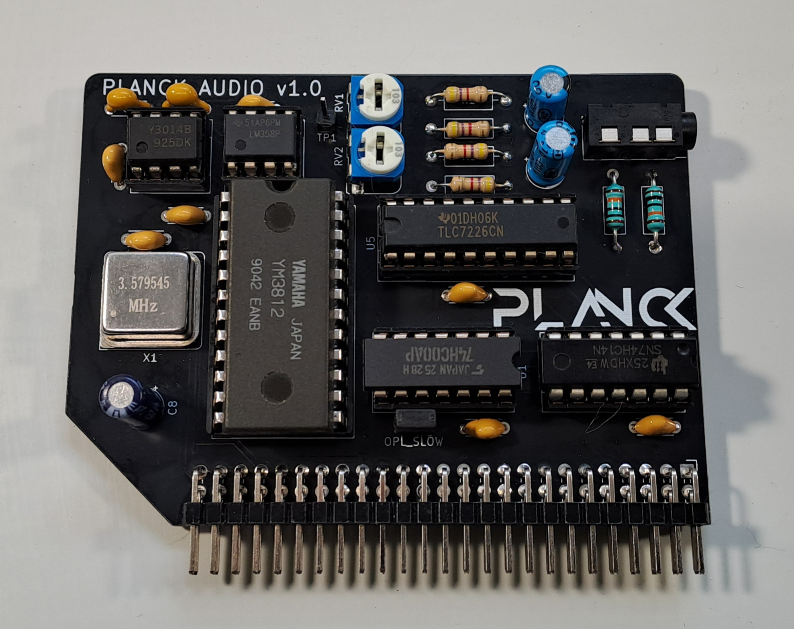

## Planck 6502 audio card



This is an audio card for the Planck 6502 computer.

It is a major modification of the original Planck sound card, which was based solely on the OPL2 chip.

## Revision History

| Version | Status | Changes |
| :---: | :---: | :--- |
| **1.0** | Tested and working | Initial release |

**This version is tested and working.**

This card integrates two sound chips on a single board. The first is the TLC7226CN, a 4-channel, 8-bit DAC (Digital-to-Analog Converter) that enables the Planck to play 8-bit samples. The four independent audio channels are paired into left and right channel outputs, allowing for true stereo sound playback. The second chip is the Yamaha YM3812 (OPL2), which handles FM-based synthesis. This chip was famously used in the AdLib and early Sound Blaster sound cards.

See an [example of the card's capabilities](https://youtube.com/shorts/hnlIDgAt0dc?si=HoMWPFpHYaL4QCAE).

The memory mapping for this card is as follows:

```asm
DAC_RIGHT_1 = SOUND_CARD_PORT + 0
DAC_LEFT_1  = SOUND_CARD_PORT + 1
DAC_LEFT_2  = SOUND_CARD_PORT + 2
DAC_RIGHT_2 = SOUND_CARD_PORT + 3

OPL_ADDR = SOUND_CARD_PORT + 8
OPL_DATA = SOUND_CARD_PORT + 9
```