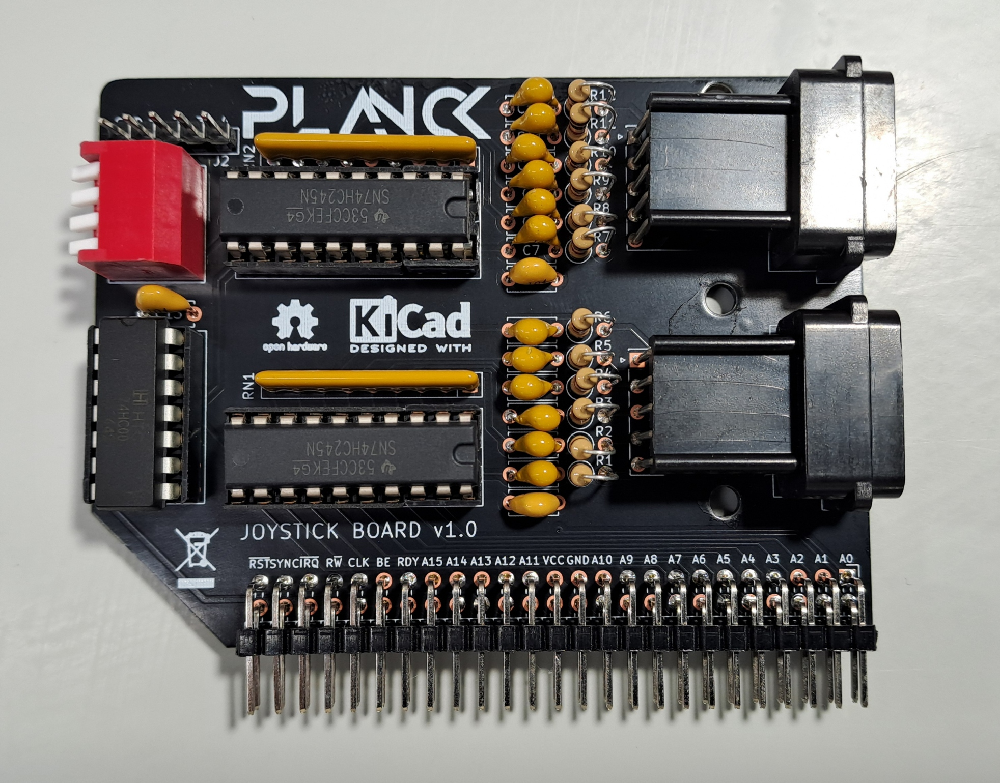

## Planck 6502 Joystick Interface

This is the dual joystick interface card for the Planck 6502 computer.

This is an entirely new build, not based on any existing board from the original Planck project.

## Revision History

| Version | Status | Changes |
| :---: | :---: | :--- |
| **1.0** | Tested and working | Initial design |

**This version is tested and working.**

## Features
* **2x DE-9 Ports:** `JOY0` and `JOY1` (4 directions + 2 Fire buttons).
* **Active-Low Logic:** Internal pull-ups keep idle pins at `1`; pressing a direction/button or turning a DIP switch ON shorts the line to `GND` (`0`).
* **4-bit DIP Switch:** Mapped to bits `6..7` of both ports for boot-time hardware configuration.

## Memory Map

| Offset | Address | Register | Mode | Description |
| :--- | :--- | :--- | :--- | :--- |
| `+$00` | `CARD_BASE_ADDR` | **PORT_JOY0** | R | Joystick 0 + DIP switches `SW1`, `SW2` |
| `+$01` | `CARD_BASE_ADDR + 1` | **PORT_JOY1** | R | Joystick 1 + DIP switches `SW3`, `SW4` |

### `PORT_JOY0` (`CARD_BASE_ADDR + $00`)
| Bit | 7 | 6 | 5 | 4 | 3 | 2 | 1 | 0 |
| :--- | :---: | :---: | :---: | :---: | :---: | :---: | :---: | :---: |
| **Signal** | `DIP_2` | `DIP_1` | `FIRE 2` | `FIRE 1` | `RIGHT` | `LEFT` | `DOWN` | `UP` |
| **Source** | SW2 | SW1 | Pin 9 | Pin 6 | Pin 4 | Pin 3 | Pin 2 | Pin 1 |

### `PORT_JOY1` (`CARD_BASE_ADDR + $01`)
| Bit | 7 | 6 | 5 | 4 | 3 | 2 | 1 | 0 |
| :--- | :---: | :---: | :---: | :---: | :---: | :---: | :---: | :---: |
| **Signal** | `DIP_4` | `DIP_3` | `FIRE 2` | `FIRE 1` | `RIGHT` | `LEFT` | `DOWN` | `UP` |
| **Source** | SW4 | SW3 | Pin 9 | Pin 6 | Pin 4 | Pin 3 | Pin 2 | Pin 1 |