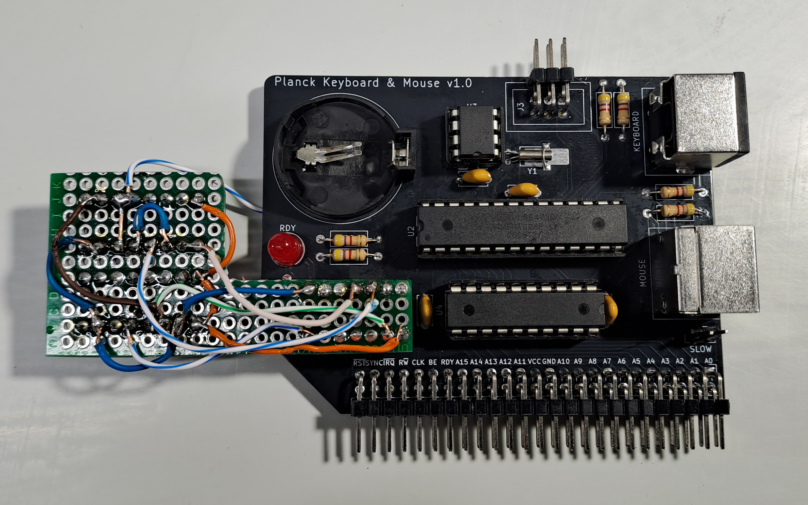

## Planck 6502 Keyboard and Mouse Interface

This is the keyboard and mouse interface card for the Planck 6502 computer.

This is an entirely new build, not based on any existing board from the original Planck project.

## Revision History

| Version | Status | Changes |
| :---: | :---: | :--- |
| **1.1** | Work in progress | RDY latch corrected, CS signal routed to ATmega |
| **1.0** | Not working | Initial design |

**Version 1.0 doesn't work correctly, version 1.1 was not tested yet**

This card was designed to act as an abstraction layer between a keyboard/mouse and the W65C02 CPU. It uses an ATmega328P microcontroller to handle all the signal translation. From the CPU's perspective, the entire card is accessible within a 16-byte memory block, and all communication is handled simply by reading from or writing to memory.

Because the ATmega may be too slow to respond directly to the CPU (which is the case when running the Planck at 12 MHz against the ATmega at 8 MHz), the card includes 74-series logic circuitry. This logic pulls the RDY line low immediately when the SLOT_SEL signal is detected, effectively pausing the CPU. Once the ATmega finishes processing the request and the data is ready, it generates a strobe signal (RDY_STROBE) to release the latch, allowing the CPU to resume execution. Note that due to this design, the card may not work with an original 6502 CPU, which handles the RDY line differently. However, since the Planck uses the W65C02, it works reliably.

The board is equipped with two PS/2 ports for connecting a keyboard and mouse, as well as a DS1307+ RTC chip with a CR2032 battery holder to provide real-time clock functionality. It also features an ISP header to flash the ATmega without removing it from the socket. Since the ISP lines are shared with the PS/2 ports, any connected PS/2 devices must be unplugged during flashing to avoid failure.

For operational details, memory mapping, and documentation, please refer to the firmware folder for this card.