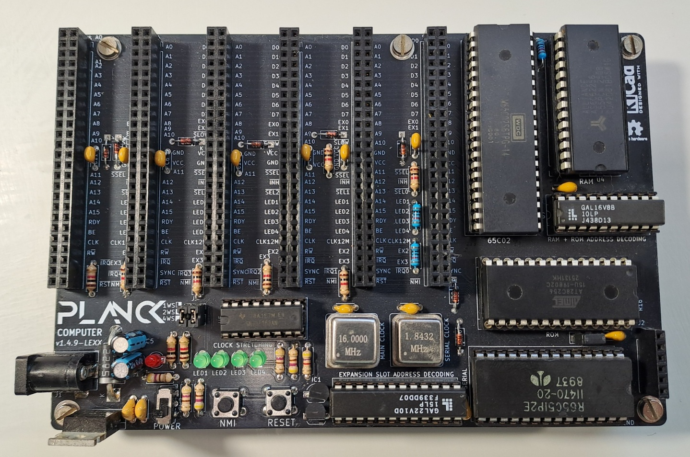

## Planck computer

This is a modified version of the original Planck mainboard, featuring a small addition that enables clock stretching for the serial interface.

Since the original design uses the W65C51 for serial communication and I had some R6551 chips on hand, I wanted to be able to use them instead. The pinout for both chips is identical; however, the R6551 can only run at a maximum of 2 MHz (depending on the version), so it cannot operate at the full CPU clock speed. With this additional jumper, it is possible to lower the clock frequency for the ACIA. Note that the main clock must be set to a maximum of 8 MHz, as the clock stretching circuit can divide the frequency by up to 4 times (meaning an original 12 MHz clock would yield 3 MHz during stretching, which is still too high for the R6551). The remainder of the design is identical to the original version.

## Revision History

| Version | Status | Changes |
| :---: | :---: | :--- |
| **1.4.9-Lexx** | Working | Forked from the project; added JP5 jumper to enable clock stretching for serial |

**This version is tested and working.**

Below is the original documentation excerpt:

This is a complete computer based on the Planck 6502 backplane.

It provides a 65c02 cPU, 32k of RAM, 32k of ROM and a serial port, as well as 6 expansion slots.

The board exceeds the original size specification of the original project (100 x 150mm instead of 100 x 100mm) but it seems that the cost will be similar (one more expensive board replaces 3 cheaper boards) as well as being more practical for some applications.

This computer can run absolutely stand alone when connected via the serial port. It can also accommodate 2 more expansion cards compared to the original backplane.

Here is a 3D view of the board:

You can [download the schematic](https://planck6502.com/fabrication/mainboard-schematic.pdf) and the [gerber files](https://planck6502.com/fabrication/mainboard-zip.zip)

[Documentation](https://planck6502.com/Hardware/io/)

 This documentation is licensed under a <a rel="license" href="http://creativecommons.org/licenses/by-sa/4.0/">Creative Commons Attribution-ShareAlike 4.0 International License</a>.