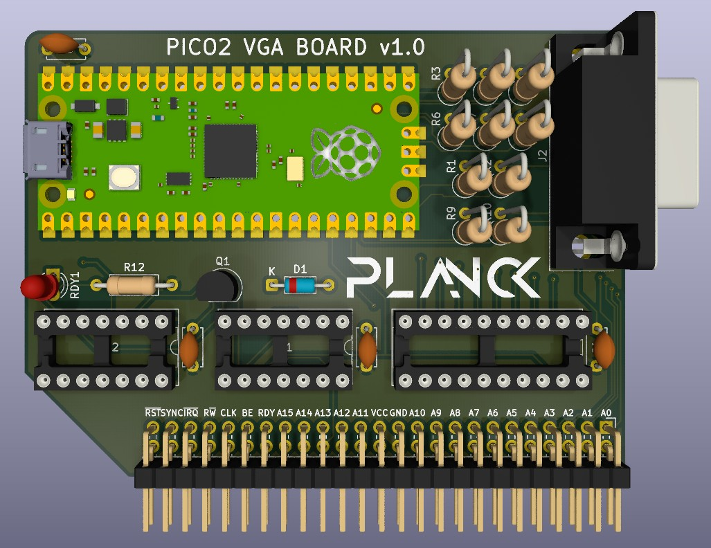

## Planck 6502 Pico 2 VGA Board 

This is a VGA board for the Planck 6502 computer, based on the Raspberry Pi Pico 2. 

> [!CAUTION]
> **Compatibility Warning:**  
> This version is **not** compatible with the 1st generation Pico, as it is not 5V tolerant. **Use the Pico 2 only**, otherwise you risk damaging the board.

Compared to the original design, this card was rebuilt from scratch to achieve three main goals:
1. **PicoVGA Compatibility:** The pinout and resistor ladder match the [PicoVGA cmake](https://github.com/codaris/picovga-cmake) project, making the library as simple as possible to use.
2. **Hardware RDY Latch:** Implemented to give the Pico enough time to read, process, and respond to the W65C02 CPU by utilizing the RDY signal to pause the CPU when needed.
3. **Optimized Bus Routing:** The Address and Data bus pinout order was reversed to enable faster and more efficient bus operations on the Pico. 

Additionally, by leveraging the Pico 2, SMD level shifters were removed, leaving only a single THT bus buffer on the PCB. As a result, the entire board can now be soldered using strictly Through-Hole (THT) components.

## Revision History

| Version | Status | Changes |
| :---: | :---: | :--- |
| **1.0** | Work in progress | Initial design |

