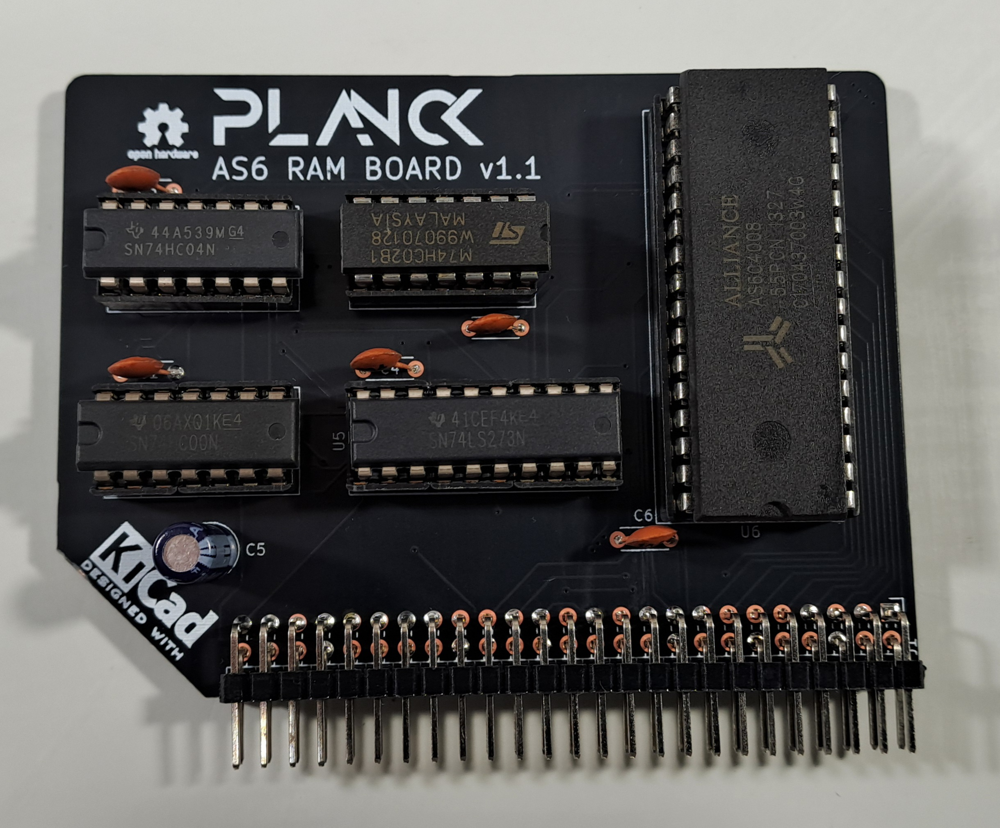

## Planck 6502 AS6 RAM board



This is a banked RAM board for the Planck 6502 computer (AS6C4008-55PCN version).

The original project used the IS61C5128AL-10TLI, which was hard for me to obtain and was an SMD version. The AS6 is THT, so the soldering process should be much easier.

## Revision History

| Version | Status | Changes |
| :---: | :---: | :--- |
| **1.1** | Tested and working | WE signal is now active only when CPU operates in RAM expansion card window |
| **1.0** | Partially working | Forked from original banked RAM project, replacing IS6 with AS6 |

**Version 1.1 is tested and working.**

## How It Works

When active, this expansion maps a bank of RAM into the `$8000–$BFFF` address space, overriding the system ROM in that range. 

### Memory & Banking
* **Address Space:** `$8000–$BFFF` (16 KB window)
* **Total Banks:** 32 (Banks `0` through `31`)
* **Control Register:** The first register of the assigned slot (e.g., `$FFD0`).
* **State Visibility:** The control register is **write-only**; there is no way to read back the currently active bank.

### Register Bitmask
To control the RAM card, write a byte to the slot's first register using the following bit layout:

| Bit | 7 | 6 | 5 | 4 | 3 | 2 | 1 | 0 |
| :--- | :---: | :---: | :---: | :---: | :---: | :---: | :---: | :---: |
| **Function** | **Enable** (`1` = RAM, `0` = ROM) | *Unused* | *Unused* | **Bank Select** (`0–31`) | **Bank Select** | **Bank Select** | **Bank Select** | **Bank Select** |

* **Bit 7 (Enable):** Set to `1` to enable banked RAM, or `0` to disable it and restore ROM access.
* **Bits 0–4 (Bank Select):** A 5-bit value (`$00–$1F`) specifying which of the 32 banks to map into `$8000–$BFFF`.

### Usage Examples (6502 Assembly)

*Assuming the card is installed in the slot mapped to `$FFD0`:*

**Activate Bank 0:**
```assembly
lda #$80        ; Bit 7 = 1 (Enable), Bits 0-4 = 0 (Bank 0)
sta $FFD0       ; Map Bank 0 into $8000-$BFFF
```

**Switch to Bank 14:**
```assembly
lda #$8E        ; Bit 7 = 1 (Enable), Bits 0-4 = 14 ($0E)
sta $FFD0       ; Map Bank 14 into $8000-$BFFF
```

**Deactivate RAM (Restore ROM):**
```assembly
lda #$00        ; Bit 7 = 0 (Disable)
sta $FFD0       ; Unmap RAM and restore ROM at $8000-$BFFF
```

<a rel="license" href="http://creativecommons.org/licenses/by-sa/4.0/"></a><br />This documentation is licensed under a <a rel="license" href="http://creativecommons.org/licenses/by-sa/4.0/">Creative Commons Attribution-ShareAlike 4.0 International License</a>.