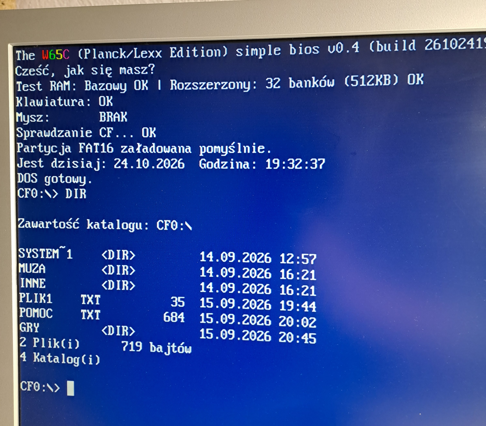
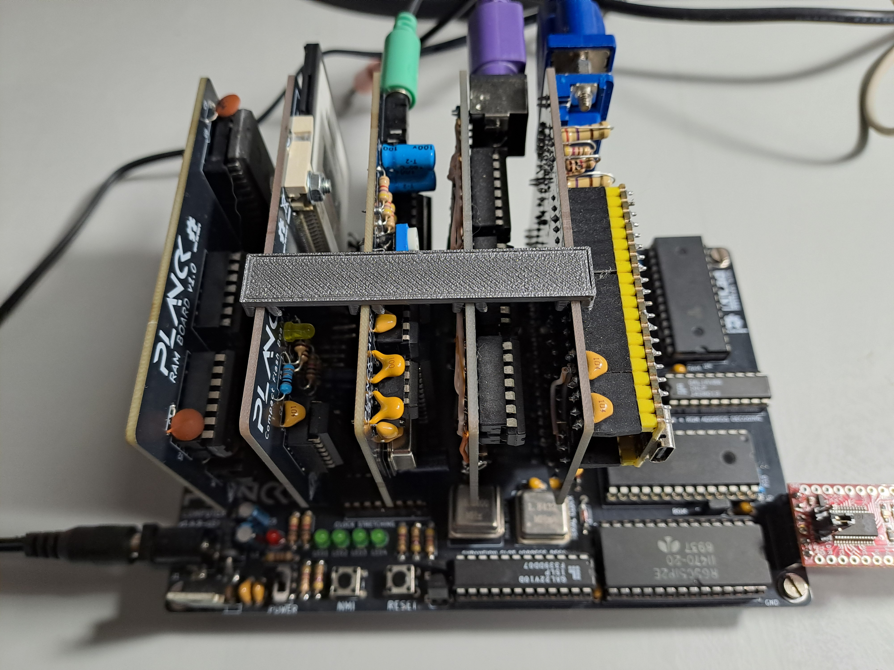

# Planck/Lexx W65C02 computer

My custom build of the W65C02 computer, based mostly on the [Planck6502](https://planck6502.com/) hardware design along with several new add-ons.
The firmware has been written entirely from scratch and does not use any of the original Planck code.

The system features a simple DOS-like environment that uses a single CompactFlash (CF) card formatted with a FAT16 partition for storage, enabling seamless file exchange with modern PCs. From the DOS prompt, the user can launch a BASIC interpreter, run a machine-language monitor, or execute custom applications written for the system—much like in MS-DOS.

From a hardware perspective, the computer is equipped with a Pico 2-based video card capable of driving a 640x480 video output with 256 colors. It emulates a VT100 terminal with ANSI color support and provides an 80x25 text mode very similar to standard VGA. The system also features an audio card equipped with a 4-channel, 8-bit DAC for stereo PCM playback, as well as a Yamaha OPL2 chip for FM synthesis.

Mass storage is handled via CF cards, and the base memory (32 KB RAM) is expandable via memory banking. User interaction is supported through standard PS/2 keyboard and mouse interfaces, and an onboard serial interface provides full terminal access as well as file transfer capability.
